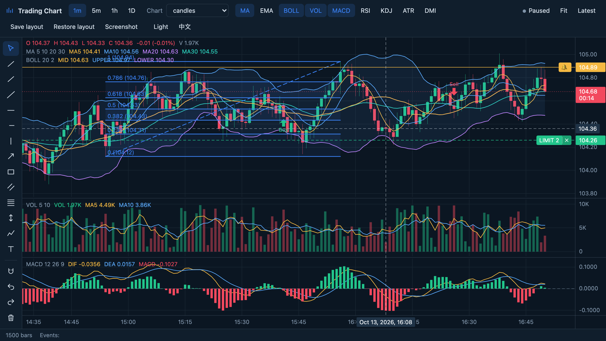

<div align="center">

# Trading Chart SDK

**A framework-agnostic Canvas SDK for trading charts: candlesticks, indicators, drawing tools, draggable orders and price alerts, in 68 kB gzipped.**

[](LICENSE)
[](CHANGELOG.md)
[](https://github.com/ruoyu-lab/trading-chart-sdk/actions/workflows/ci.yml)
[](tsconfig.base.json)
[](scripts/check-size.mjs)
[](#packages)

[**Live demo**](https://ruoyu-lab.github.io/trading-chart-sdk/) · **English** · [简体中文](README.zh-CN.md)

</div>

---

<p align="center">
  
</p>

Trading Chart SDK renders financial charts on Canvas with no runtime dependencies. You create a chart in any element with `createChart()`, then drive it through a typed, namespaced API: stream bars, add indicators, let users draw, show orders they can drag, and get notified when price alerts fire.

The core knows nothing about frameworks. It works in plain JavaScript, and thin official adapters make it a first-class component: [Vue 3](packages/vue) and [React](packages/react). Everything the adapters do is public API, so wrapping the chart for any other framework takes a few dozen lines.

## Highlights

<table>
<tr>
<td width="50%" valign="top">

### 📈 Charts

- 11 series types: candles, hollow candles, OHLC, high-low, line, step line, line with markers, area, baseline, HLC area and columns
- Any number of panes, resizable by dragging their separators
- Normal, logarithmic, percent and indexed price scales per pane
- Calendar-aware time axis, any locale and IANA time zone
- Latest-price line with a bar-close countdown, OHLC legends, crosshair
- Dark and light themes, every color and font configurable

</td>
<td width="50%" valign="top">

### 🧮 Indicators

- 19 built-ins: MA, EMA, SMMA, BOLL, VOL, MACD, RSI, KDJ, WR, CCI, ROC, BIAS, OBV, VR, EMV, MFI, ATR, STD, DMI
- Formulas follow the conventions of Chinese charting software (同花顺 / 通达信)
- Streaming calculation: a real-time tick costs one step, not a full recompute
- Custom indicators from a few lines: compute from a window of bars, or write a full streaming calculator

</td>
</tr>
<tr>
<td width="50%" valign="top">

### ✏️ Drawing tools

- 13 built-ins: trend line, ray, extended line, arrow, horizontal line and ray, vertical line, rectangle, parallel channel, Fibonacci retracement, price range, path and text
- Click-click or press-drag placement, magnet snapping to OHLC values
- Move whole drawings or single anchors, lock and hide them
- Undo and redo, keyboard shortcuts, custom tools through a small interface

</td>
<td width="50%" valign="top">

### 💹 Trading

- Order lines the user drags to a new price, with `start → move → end` events and cancel on Escape
- Label buttons with text or SVG icons, e.g. cancel an order in place
- Execution and signal markers pinned to bars
- Price, indicator and series alerts: cross, cross up/down, above, below, fired once, once per bar, on bar close or every time
- Alerts are evaluated on every data update, also in background tabs

</td>
</tr>
<tr>
<td width="50%" valign="top">

### ⚡ Performance

- Columnar bar storage in typed arrays, O(1) real-time updates
- Three canvas layers: data, objects and crosshair repaint independently
- All work coalesced into one animation frame; point buffers are reused between frames
- Smooth with hundreds of thousands of bars; mouse, trackpad, touch and pinch

</td>
<td width="50%" valign="top">

### 🧩 Developer experience

- Strict TypeScript types for every option, event and payload
- API calls never emit events, only user actions do, so feeding state back cannot loop
- Invalid input throws a `ChartError` that names the bad value; nothing is silently "fixed"
- Save and restore the user's layout (panes, indicators, drawings, view) as JSON

</td>
</tr>
</table>

## Packages

| Package                                      | Description                     |
| -------------------------------------------- | ------------------------------- |
| [`@trading-chart-sdk/core`](packages/core)   | The framework-agnostic core SDK |
| [`@trading-chart-sdk/vue`](packages/vue)     | Vue 3 component and composable  |
| [`@trading-chart-sdk/react`](packages/react) | React component and hook        |

## Quick start

```bash
npm install @trading-chart-sdk/core
```

```ts
import { createChart } from '@trading-chart-sdk/core';

const chart = createChart(document.getElementById('chart')!, {
  locale: 'en-US',
  timeZone: 'America/New_York'
});

chart.data.set(bars); // [{ time, open, high, low, close, volume }]
chart.indicators.add({ type: 'MA', params: { periods: [5, 10, 20] } });
chart.indicators.add({ type: 'MACD' });

socket.onmessage = (event) => chart.data.update(JSON.parse(event.data));
```

The chart fills its container and follows its size. `time` accepts epoch milliseconds, ISO strings or `Date` objects.

<details>
<summary><b>Without a bundler</b></summary>

```html
<script src="https://cdn.jsdelivr.net/npm/@trading-chart-sdk/core@0.1.0-beta.2"></script>
<div id="chart" style="height: 480px"></div>
<script>
  const chart = TradingChart.createChart(document.getElementById('chart'));
  chart.data.set(bars);
</script>
```

</details>

### Vue 3

```bash
npm install @trading-chart-sdk/core @trading-chart-sdk/vue
```

```vue
<script setup lang="ts">
import { TradingChart } from '@trading-chart-sdk/vue';
import type { Chart } from '@trading-chart-sdk/core';

function onReady(chart: Chart) {
  chart.indicators.add({ type: 'VOL' });
}
</script>

<template>
  <TradingChart
    style="height: 480px"
    :data="bars"
    :orders="orders"
    :options="{ locale: 'zh-CN' }"
    @ready="onReady"
    @order-drag="(event) => event.phase === 'end' && moveOrder(event.id, event.price)"
  />
</template>
```

### React

```bash
npm install @trading-chart-sdk/core @trading-chart-sdk/react
```

```tsx
import { TradingChart } from '@trading-chart-sdk/react';
import type { Chart } from '@trading-chart-sdk/core';

const options = { locale: 'zh-CN' };
const onReady = (chart: Chart) => chart.indicators.add({ type: 'VOL' });

export const View = () => (
  <TradingChart
    style={{ height: 480 }}
    data={bars}
    orders={orders}
    options={options}
    onReady={onReady}
    onOrderDrag={(event) => event.phase === 'end' && moveOrder(event.id, event.price)}
  />
);
```

## A closer look

**History on demand.** When the user scrolls near the oldest bar, `loadMore` asks for more. It fires once per page, never on real-time ticks.

```ts
chart.on('loadMore', async ({ before }) => {
  chart.data.prepend(await api.bars({ end: before, limit: 500 }));
});
```

**Orders the user can move.** The line follows the pointer at once; your broker call decides what happens next.

```ts
chart.orders.set([
  {
    id: 'o-1',
    side: 'buy',
    price: 101.5,
    label: 'LIMIT',
    quantity: 2,
    buttons: [{ id: 'cancel', icon: 'M6 6L18 18M18 6L6 18' }]
  }
]);

chart.on('orderDrag', async ({ id, phase, price, initialPrice }) => {
  if (phase === 'end' && !(await broker.modify(id, price))) {
    chart.orders.update(id, { price: initialPrice });
  }
});

chart.on('buttonClick', ({ id, buttonId }) => buttonId === 'cancel' && broker.cancel(id));
```

**Alerts on any value.** Watch the price, an indicator output or another series.

```ts
const macd = chart.indicators.add({ type: 'MACD' });
chart.alerts.add({
  id: 'golden-cross',
  source: { kind: 'indicator', id: macd, key: 'dif' },
  trigger: 'cross-up',
  value: { kind: 'indicator', id: macd, key: 'dea' },
  frequency: 'once-per-bar-close'
});
chart.on('alertTrigger', ({ id, time, value }) => notify(id, time, value));
```

**Your own indicator.** Compute each value from the latest bars, and the chart takes care of the rest.

```ts
chart.indicators.register<{ period: number }>('MOM', {
  name: 'MOM',
  pane: 'new',
  precision: 2,
  params: { period: { default: 10, min: 1, integer: true } },
  outputs: () => [{ key: 'mom', label: 'MOM', plot: { kind: 'line' } }],
  lookback: ({ period }) => period + 1,
  compute: (window) => [window.price(window.length - 1) - window.price(0)]
});
```

**Layouts that persist.** Panes, indicators, drawings and the view round-trip through JSON. Loading is all or nothing: an invalid state throws and changes nothing.

```ts
localStorage.setItem('layout', JSON.stringify(chart.saveState()));
chart.loadState(JSON.parse(localStorage.getItem('layout')!));
```

## Documentation

|                                            |                                                          |
| ------------------------------------------ | -------------------------------------------------------- |
| [Getting started](docs/getting-started.md) | Installation, data, sizing, themes, real-time updates    |
| [API reference](docs/api.md)               | Every method, option and event                           |
| [Indicators](docs/indicators.md)           | Built-in indicators, their parameters, custom indicators |
| [Drawings](docs/drawings.md)               | Tools, editing, undo, custom drawing types               |
| [Trading](docs/trading.md)                 | Orders, markers and alerts                               |
| [Vue](docs/vue.md)                         | The Vue 3 component and composable                       |
| [React](docs/react.md)                     | The React component and hook                             |
| [Architecture](docs/architecture.md)       | How the core is built, for contributors                  |

Try the [live demo](https://ruoyu-lab.github.io/trading-chart-sdk/), or run it locally with `npm install && npm run dev`.

## Browser support

The latest two versions of Chrome, Edge, Firefox and Safari, including iOS Safari. The chart needs Canvas 2D, Pointer Events, `ResizeObserver` and `Intl`, and throws a `ChartError` naming any that is missing.

## Development

```bash
npm install
npm run dev          # playground at http://localhost:5180
npm test             # unit tests
npm run test:e2e     # Chromium, Firefox and WebKit
npm run verify       # architecture, lint, format, types, tests, build, bundle size
```

## Roadmap

- More drawing tools (pitchfork, Gann, Elliott waves)
- Comparison mode with several symbols on one percent scale

## License

[MIT](LICENSE) © 2026 ruoyu-lab
